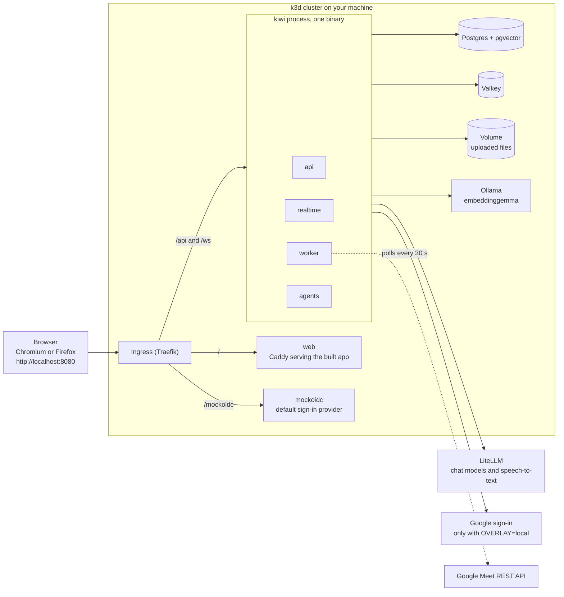

# K.I.W.I.

**Knowledge, Intelligence & Workflow Integration** is a team workspace (channels and real-time chat) with AI agents built in. It turns meetings, uploaded files and conversations into summaries, draft tasks and answers that cite their sources, in English and Thai. Nothing the AI drafts takes effect until a person confirms it.

Built for the AI Builder Cup 2026. **This repository holds the local phase: the whole product runs on one machine**, in a k3d cluster driven by Tilt. There is no deployed instance yet ([Deployment](#deployment-not-yet-built)). All demo content is synthetic.

Every statement here about how something was checked says whether it was **automated**, **simulated** or **real-condition**; the terms are defined in [What was checked, and how](#what-was-checked-and-how).

## What it does: the five demo flows

| # | Flow | What you see |
|---|---|---|
| 1 | Sign in and chat | Sign in with Google and land in `#general`. A message in English or Thai reaches the other member without a reload; a message sent while offline waits, says so, and arrives once when the connection is back. |
| 2 | Meeting summary and action items | A recording uploaded to a channel becomes a summary slip with its decisions, open questions and action items, and AI drafts of the tasks. A Google Meet started from a channel is built to feed the same pipeline, but no real Meet transcript has been obtained (see [Limitations](#limitations-of-this-phase)), so the demo runs this flow on the recording upload. |
| 3 | AI-drafted tasks on the Board | The AI's drafts wait for a person. Pick an owner, press Confirm: the stub tears away, the slip is sealed, and the task lands in To do, from where a menu moves it on. |
| 4 | Cited answers in English and Thai | Ask a question on the Ask page. The answer is a slip with a REF code and clickable sources; a Thai question gets a Thai answer. Every Ask is answered from a search made for that question itself, never from the earlier conversation, so an answer always carries its sources; when nothing is found, the not-found slip says so and names the channels searched. Someone who is not a member of a channel gets a "not found in channels you can access" answer, never its content. |
| 5 | Instant file summaries | Attach a file to a channel and its summary slip arrives with a REF code. A type that is not supported is refused where it is attached; a scan with no text layer fails with its reason and a Retry button. |

Every AI result is a **slip**: it carries its sources and a REF code (`MTG-…` for a meeting, `DOC-…` for a file, `ANS-…` for an answer, `TSK-…` for a task). A failed attempt shows its reason with Retry and issues no REF.

**Which channels an answer searches.** An @mention of the assistant in a channel and an Ask opened from a channel search only that channel: in such a run the assistant's search, channel-summary and task tools refuse any other channel (checked by **automated** tests of the tools). That limits what the tools read; it does not cover what the model writes from its own conversation or session memory. An Ask opened from the Ask panel without a channel searches every channel the person belongs to. A same-topic question about content that lives in another channel therefore answers "not found" in the wrong channel: ask in the right channel, or from the Ask panel.

## How it runs locally



- One Go binary, `kiwi`, runs the four roles (api, realtime, worker, agents) in one process, with an in-process message bus. Work is queued through a transactional outbox in Postgres, so a restart in the middle of a job redelivers it instead of losing it.
- Postgres isolates workspaces with row-level security; Valkey holds sessions, realtime tickets and the fan-out of live events; uploaded files live on a volume and are served through signed URLs.
- Chat models and speech-to-text come from an OpenAI-compatible LiteLLM gateway that your team provides. Embeddings (768 dimensions) come from Ollama in the cluster and run on the CPU.
- Google Meet has no push delivery in this phase: the worker polls the Meet REST API for the meetings you started from K.I.W.I.

## Run it locally

**You need** Docker (running), [mise](https://mise.jdx.dev), and Chromium or Firefox. Run the commands in a shell where mise is activated, or prefix them with `mise exec --`. `task smoke` and `task reset` also need GNU coreutils `timeout` (on macOS, `brew install coreutils` provides `gtimeout`, which the scripts use when there is no `timeout`).

### 1. Toolchain and dependencies

```bash
mise install
task setup
```

`mise install` installs the pinned tools of `mise.toml` (Go, Node, pnpm, task, k3d, Tilt, kubectl, kustomize and the rest). `task setup` installs the git hooks (they refuse private paths and secrets before a commit) and the JavaScript dependencies.

### 2. Fill in `.env`

```bash
bash scripts/local/gen-env.sh
```

This creates `.env` from `.env.example` (git-ignored, mode 600) and generates the three local secrets (two keys and the database password). Then edit `.env`. `.env.example` lists every variable name with an empty value; a test keeps it in step with the code. The Secret the cluster reads is built from `.env` by `scripts/local/load-env-secret.sh`; no secret value is ever written into a manifest or committed.

| Variable | Where it comes from |
|---|---|
| `KIWI_LLM_BASE_URL`, `KIWI_LLM_API_KEY` | Your team's LiteLLM gateway, shared out of band. The base URL has no `/v1` suffix: K.I.W.I. appends the API path. |
| `KIWI_LLM_MODEL_FLASH`, `KIWI_LLM_MODEL_PRO`, `KIWI_ASR_MODEL` | Model ids that your LiteLLM serves: two chat models and a speech-to-text model. |
| `KIWI_TOKEN_ENC_KEY`, `KIWI_BLOB_SIGNING_KEY`, `KIWI_DB_PASSWORD` | Generated by `gen-env.sh` when empty (`task local:up` runs it too). A value that is already set is never touched. |
| `KIWI_OAUTH_CLIENT_ID`, `KIWI_OAUTH_CLIENT_SECRET` | The Google OAuth client, needed only for real Google sign-in ([below](#real-google-sign-in)). The default stack signs in through a mock provider and fills in a placeholder itself: leave them empty. |
| `KIWI_WORKSPACE_NAME`, `KIWI_WORKSPACE_DOMAIN` | Optional; they only change the sign-in heading and its domain hint. |
| The rest of `.env.example` | Set by the overlay in `deploy/k8s/overlays`: leave empty. |

### 3. Start the cluster

```bash
task local:up
```

This creates (or starts) the k3d cluster `kiwi`, loads `.env` into the cluster, and runs Tilt with the `mockauth` overlay. Tilt builds the images and deploys Postgres, the migration job, Valkey, Ollama (the first start downloads the embedding model), then `kiwi` and `web`. It stays in the foreground: use a second terminal for the next step, and wait until Tilt shows every resource ready.

The app is published on `127.0.0.1:8080` only, so other machines on your network cannot reach it: the default stack lets whoever reaches it sign in as a demo person without a password, and the cluster holds your LLM key. The Kubernetes API port of the cluster is bound to `127.0.0.1` too (k3d publishes it on every interface by default: observed on a cluster created before this change). To use the app from another machine, tunnel to it with `ssh -N -L 8080:127.0.0.1:8080 <host>` and open `http://localhost:8080` there: the browser origin has to stay `http://localhost:8080`, which the OAuth redirect URI requires. A cluster created before these bindings existed keeps its old ones (every interface) until it is recreated with `task local:down` and `task local:up` (that deletes its data); `task local:up` prints a WARNING for each port it finds public on such a cluster. On a cluster recreated from the new configuration both ports were on `127.0.0.1` only (`docker port`, `ss -ltn`) and `kubectl` worked through the kubeconfig k3d wrote for it (**real-condition**). On that host `localhost` resolves to `::1` first, which is refused because the binding is IPv4 only, so `http://localhost:8080` reaches the app through the client's fallback to `127.0.0.1` (Node's `fetch` and `http` and the headless Chromium of `task smoke` did).

A client without that fallback to `127.0.0.1` fails on `localhost`, because the IPv4-only binding refuses `::1`, and it cannot work around that by switching the host: the OAuth redirect URI requires `localhost`. The clients named above are the ones that were tried.

If, after a Docker or host restart, the k3d agent node stays `NotReady` with "failed to find interface with specified node ip", `docker restart k3d-kiwi-agent-0` fixes it (seen once, on rootless Docker: **real-condition**).

### 4. Seed the demo workspace

```bash
task seed
```

With no flags this seeds the workspace `demo.example` with its channels, messages, documents and AI drafts, and invites alice and bob. `task seed -- --help` lists the flags.

### 5. Open the app

Open `http://localhost:8080` in Chromium or Firefox and press **Continue with Google**. The default stack (the `mockauth` overlay, which `task local:up` selects; `OVERLAY=mockauth task local:up` says it explicitly) needs no Google client: the button goes through a mock sign-in provider on the same origin, where a chooser offers three accounts.

| Account | Mock token | Result |
|---|---|---|
| alice@demo.example | has a hosted domain (`demo.example`) | signs in |
| bob@demo.example | no hosted domain; invited by the seed | signs in |
| carol@elsewhere.example | no hosted domain; not invited | refused with K.I.W.I.'s "has not been invited" page |

Use this stack if you are not a test user of the team's Google OAuth app, or not seeded. Stop everything with `task local:down`, which deletes the cluster, its registry and its volumes (so all local data).

### Real Google sign-in

Sign-in is **invite-only**. Only an address that already has a user row can sign in: `kiwi seed --members <emails>` creates them (an invite flow does not exist yet). Any other Google account gets K.I.W.I.'s own "has not been invited" page naming the address. A token that carries a Google Workspace hosted domain (`hd`) must match the domain of an existing workspace; sign-in never creates a workspace.

To set up the Google side (nothing secret goes into the repository):

1. Use one Google Cloud project.
2. Configure the OAuth consent screen as **External** with publishing status **Testing**, and add every person who will sign in as a **test user**. Google stops anyone else with `access_denied`.
3. Request the scopes `openid`, `email`, `profile` and `https://www.googleapis.com/auth/meetings.space.created`.
4. Enable the Google Meet REST API.
5. Create an OAuth client of type **Web application** with the redirect URI `http://localhost:8080/api/auth/callback`.
6. Put its client id and secret into the git-ignored `.env` as `KIWI_OAUTH_CLIENT_ID` and `KIWI_OAUTH_CLIENT_SECRET`.
7. Stop Tilt (Ctrl-C in the terminal where `task local:up` is running), then start the stack with the real sign-in and seed yourself:

```bash
OVERLAY=local task local:up
task seed -- --members you@gmail.com
```

With `--members` alone, `task seed` creates the one workspace without a Google domain, called "Team". Two demo people, Nok and Pim, on the reserved `.invalid` top-level domain (no Google account can have such an address), own the channels and write the demo conversation; the addresses you list are plain members of the public channels and cannot read the private one. Separate several addresses with commas. Add `--domain <workspace domain>` (together with `--members`) only if your team has a Google Workspace domain.

Switching overlays keeps the data that is already in the cluster: a `demo.example` workspace seeded on the mock stack coexists with "Team". Three commands remove it: `task local:down`, and `task smoke` and `task reset` ([Testing](#testing)), which wipe the workspace data of the cluster, a real-Google "Team" workspace and its Meet grant included.

How this was checked: **real-condition**, by a human, once, through an External/Testing OAuth client: the consent screen, then the "has not been invited" page for a test user who was not yet seeded, then the sign-in of the invited test user. The `hd` (Workspace) branch is built and tested but cannot be exercised for real without a Workspace domain: **automated** and **simulated** checks only.

## Testing

```bash
task test
task lint
task check:scripts
task smoke
KIWI_LIVE_E2E=1 task smoke
```

- `task test` runs the Go tests with the race detector, then the TypeScript tests. The Go tests start real Postgres and Valkey containers, so Docker must be running. On rootless Docker, if starting containers fails with `bind: address already in use`, run `cd backend && go test -race -p 1 ./...` instead.
- `task lint` checks Go formatting, runs golangci-lint and the TypeScript linters.
- `task check:scripts` runs the guard suites of the manifests and scripts. They need no cluster and no Docker, but network access: kubeconform downloads the Kubernetes schemas from `raw.githubusercontent.com` (observed: with no network it reports an error for every resource). The suites are `scripts/local/render.test.sh` (the rendered overlays through kustomize and kubeconform, the Caddyfile through `caddy validate`, the Tiltfile, the cluster scripts), `scripts/hygiene/{check-paths,gitleaks,readme}.test.sh` (the private-path and secret guards, and this README: its commands exist and it holds no secret, private address or dead link) and `scripts/smoke/run.test.sh` (the end of `task smoke` and `task reset`: the order of their steps, what they refuse, their exit status and last line, with every program they call replaced by a stub). It needs kustomize, kubeconform, gitleaks and task on `PATH` (`mise install` provides them, and caddy; without caddy the Caddyfile check is skipped, loudly); the checks of the README suite that read your `.env` are skipped, loudly, where there is none. `task gen:check` runs the generated-code drift check (`task gen`, then a diff: stage generated files first).
- `task smoke` runs the five flows in headless Chromium (a desktop viewport; flows 1 and 3 again at a 390x844 phone viewport) from a clean seed, with a recorded LLM and the mock sign-in, so it needs no model session. **It wipes the workspace data of the cluster** (every table of the application schemas and Valkey: a real-Google "Team" workspace and its Meet grant included), seeds `demo.example` with alice and bob, and runs the suite. It installs the JavaScript dependencies as the lockfile has them, builds the Playwright browsers with Nix when `PLAYWRIGHT_BROWSERS_PATH` is not set (elsewhere, point that variable at a Playwright browsers directory with the chromium headless shell that the pinned `@playwright/test` runs), and at the end removes the older Tilt-built images from the host (the newest of each repository, and every image a container uses, are kept). A machine with the five LLM values (`KIWI_LLM_BASE_URL`, `KIWI_LLM_API_KEY`, `KIWI_LLM_MODEL_FLASH`, `KIWI_LLM_MODEL_PRO`, `KIWI_ASR_MODEL`) in `.env` ends on the `mockauth` overlay, wiped again and freshly seeded with the default seed (`demo.example`: alice and bob). A machine without them cannot start `mockauth`: it ends on the `smoke` overlay, still holding the replay's seed, and says so on its last line. Flags after `--` go to Playwright; `task smoke -- --list` lists the suite and touches nothing.
- `task smoke` and `task reset` put a limit on the steps that can wait on kiwi, the database or a model: the scripts' own steps use GNU coreutils `timeout --foreground`, so Ctrl-C reaches the command being waited for (the cost: when a limit expires, `timeout` signals only the command it started, not what that command started in turn), while Tilt and the `kubectl` waits carry their own `--timeout`. The clean-up at the end of `task smoke` removes only the older Tilt-built images of this stack from the host; nothing else is pruned.
- The smoke suite never touches live Meet: flow 2 goes through the WAV recording upload, with a recorded transcript.
- `KIWI_LIVE_E2E=1 task smoke` runs the three `@live` tests (flows 2, 4 and 5) against the real LiteLLM and Ollama (overlay `mockauth` throughout) instead of the recorded LLM. It is opt-in and never part of the default run; it needs the five LLM values in `.env`. It wipes and seeds the same way, and ends on `mockauth`, freshly seeded.
- `task reset` wipes the workspace data of the running cluster and nothing else: kiwi is stopped while the tables are truncated, Valkey is flushed, kiwi is started again; run `task seed` afterwards.
- `task reindex` rebuilds the knowledge embeddings after you change the embedding model.

Pull requests run `.github/workflows/ci.yml` (Go formatting, build and race tests; lint, typecheck and tests of the web workspaces; the `scripts` job, which runs `render.test.sh` and `run.test.sh` with kustomize, kubeconform and task built by `go install` at pinned versions; the `gen-drift` job, which runs `scripts/check-gen-drift.sh` with buf, sqlc and task built the same way; and the `iac` job, which runs `task iac:check` with Terraform, Terragrunt, TFLint and Trivy from actions pinned to a commit) and the hygiene workflow (no private paths, no secrets, and the three hygiene suites). None of it builds an image or deploys. **CI jobs added; first GitHub run pending:** the `scripts` job, the `gen-drift` job, the `iac` job and the hygiene suites step have never run on GitHub. Their commands pass locally (`task check:scripts`, `task gen:check`, `task iac:check`).

## What was checked, and how

- **automated**: runs without a person and without a real external service: unit and integration tests, linters, scripts.
- **simulated**: runs against a stand-in: a fake Google client, the mock sign-in provider, recorded LLM replies, a headless browser viewport, jsdom.
- **real-condition**: runs on the actual cluster or host, against the real service (real Google, real Meet, a real model), or on a physical device. A run can mix labels: the real cluster of `task smoke` is real-condition, but its recorded LLM, mock sign-in and headless Chromium stay **simulated**.

| Claim | How it was checked | Level |
|---|---|---|
| Google sign-in, invite-only | A human, once, through the External/Testing OAuth client: consent, the invite rejection, the sign-in of an invited test user | **real-condition** |
| The Workspace (`hd`) sign-in branch | Go tests with a fake OIDC provider; flow 1 through the mock provider | **automated**, **simulated** only |
| Start meeting (creating a Meet space) | A human, against the real Meet API, with a personal Google account | **real-condition** |
| The Meet tab opened with `authuser=<your email>` | A human, in a real browser signed in to several Google accounts (Google documents nothing about the parameter) | **real-condition** |
| Meet offering a transcript to a personal Gmail account | A human, against the real Meet API, in three calls: the poll saw each conference start and end, Meet offered neither Transcripts nor "Take notes", and no transcript was exposed | **real-condition**: unavailable for a personal Gmail account |
| Meet transcript polling and ingestion | Go tests with a fake Google client | **simulated**: no real transcript has been ingested |
| The five flows in a browser | `task smoke` (the replay run: recorded LLM, mock sign-in, headless Chromium; desktop, and flows 1 and 3 also at 390x844), run on the k3d cluster three times through the task itself (twice in a row, then once on a cluster recreated from the final tree): 9 tests each (6 desktop, 3 phone), all passed | **automated** and **simulated**: headless browsers, not a device |
| Go and TypeScript logic | `task test`: real Postgres and Valkey in containers, jsdom for the web | **automated** |
| The real LLM and embeddings | `KIWI_LIVE_E2E=1 task smoke`, twice (the second on a cluster recreated from the final tree), through the task itself on the k3d cluster: the 3 live tests passed (flow 2 with one real WAV transcription, flow 4 with four Ask runs in English and Thai that each ended in a slip with its REF, flow 5 with a file summary) and the end-of-run wipe and default seed completed | **real-condition** for the LLM and the embeddings only; the sign-in (mock) and the headless Chromium are still **simulated** |
| The app port and the Kubernetes API port bound to `127.0.0.1` | `render.test.sh` pins both lines of the k3d configuration. On a cluster recreated from it: `docker port k3d-kiwi-serverlb` showed `80/tcp -> 127.0.0.1:8080` and `6443/tcp -> 127.0.0.1:<port>`, `ss -ltn` listed both on `127.0.0.1` only, `kubectl get nodes` worked through the kubeconfig k3d wrote (it points at `https://127.0.0.1:<port>`), a connection to this host's LAN address on 8080 was refused, and `/healthz` answered 200 on `127.0.0.1:8080` and on `localhost:8080` (`localhost` resolves to `::1` first, which is refused: the clients fell back to `127.0.0.1`) | **real-condition** on this host; the SSH-tunnel route from another machine was not exercised |
| The web container (user 65532, port 8080, read-only root filesystem, no capabilities) | `render.test.sh` pins the manifest, the Dockerfile and the Caddyfile. The image was built and run once by hand outside the cluster with `docker run --read-only --cap-drop ALL`: it answered `/healthz` on 8080 as user 65532, with the three headers. The base image `caddy:2-alpine` cannot start with every capability dropped (observed: `exec /usr/bin/caddy: operation not permitted`, because its binary carries a file capability), which the Dockerfile removes. In the recreated cluster the pod was Ready with no restart, its log had no `permission denied`, it ran as uid and gid 65532 with its permitted, effective and bounding capability sets empty (`CapPrm`, `CapEff` and `CapBnd` 0), `touch` failed with "Read-only file system" under `/usr/share/caddy` and `/etc/caddy` and worked in the three emptyDirs (`/data`, `/config`, `/tmp`); through the Ingress `/`, `/signin`, `/c/x`, `/board`, `/ask`, `/sw.js`, `/manifest.webmanifest` and `/healthz` answered 200, a missing `/assets/...` file 404, and the web responses carried `X-Content-Type-Options: nosniff`, `X-Frame-Options: DENY` and `Referrer-Policy: same-origin` and no `Content-Security-Policy` (responses of the API and the mock provider come from other pods and do not carry them) | **automated**, plus one local container run by hand and the cluster pod and HTTP through the Ingress (**real-condition**) |
| A first start on an empty cluster (overlay `mockauth`) | The steps of `task local:up` up to its Tilt step, run on a freshly created cluster: `scripts/local/k3d-up.sh`, `scripts/local/gen-env.sh`, `scripts/local/load-env-secret.sh mockauth`, then `tilt ci -- --overlay mockauth` in place of the foreground `tilt up` (`task local:up` itself was not run on the empty cluster). The first `tilt ci` did not finish within 40 minutes: kiwi waited for the mock sign-in provider, whose pod sat in `CreateContainerConfigError` (`configmap "kiwi-config" not found`) because Tilt applied that ConfigMap together with the kiwi resource. It now has a resource of its own that both wait for; `render.test.sh` pins it (shown failing on the old Tiltfile, passing on the new one), and a second cluster created from nothing, with the same steps, came up with every workload healthy in about five minutes | **real-condition** (the cluster, with those steps), **automated** (the pin) |
| The guard suites in CI | Added to the workflows; `task check:scripts` and the generated-code check pass locally; the `go install` lines of the jobs (kustomize, kubeconform, task, caddy, buf, sqlc) were run locally, and the two suites of the `scripts` job passed on a runner-like `PATH` that holds only those tools, with `GITHUB_ACTIONS=true` (where a missing caddy fails the suite) | **automated** locally; the jobs have never run on GitHub |
| The Terraform modules and the Terragrunt stack (`deploy/terraform`) | `task iac:check`: 39 checks, all passed, run with every Google credential removed: formatting, `init`, `validate` and `terraform test` of the 12 modules against a mocked Google provider (the two modules that generate secrets use the real `random` provider, which only computes locally), tflint, a Trivy scan with no findings, and a render, `init` and `validate` of the 11 Terragrunt units against mock outputs. Each invariant that a plausible mistake would break (no public Cloud SQL address, TLS, deletion protection, backups, cluster-disabled Valkey, a private bucket, one always-on Cloud Run instance in prod with private-range egress, the repository and branch pin of the GitHub federation, no service-account key) was shown to fail its test when the setting was broken in a throwaway copy | **automated** only: never planned or applied against Google Cloud, so no resource exists and the provider's schema checks are all that tested the arguments |

Every cluster run reported in this README was made on one x86-64 Linux machine with rootless Docker. The real-Google and `authuser` checks by a human drove that stack from Chrome on a Mac through an SSH tunnel; no macOS host has been tried. The kiwi binary is built for the architecture that `go env GOARCH` reports on the host (the cluster follows the host's Docker); no other host architecture and no rootful Docker has been tried. CI does not run the cluster runs: the default checks are `task test` and the pull-request workflows.

Real-device behaviour of everything on the web side is **simulated** (headless Chromium, jsdom): a physical phone and installing the app as a PWA have not been checked.

## Limitations of this phase

### Google sign-in and Meet

- **Google sign-in and Meet are real only where [What was checked, and how](#what-was-checked-and-how) says so.** Sign-in, Start meeting and the Meet tab were checked against real Google by a human (**real-condition**); transcript polling and ingestion are **simulated** only, because no real transcript has ever been obtained.
- **Sign-in is invite-only.** Only an address that has a user row can sign in, and the rows are made by `kiwi seed --members <emails>`: there is no invite flow yet. A Google account without a row gets K.I.W.I.'s "has not been invited" page naming the address. A token with a Workspace hosted domain (`hd`) must match the domain of an existing workspace, and sign-in never creates a workspace. The invite rule was checked **real-condition** once; the `hd` branch is **automated** and **simulated** only.
- **An unadopted placeholder can be claimed.** A seeded address that has not signed in yet is a placeholder row: any Google account that proves that exact address, without a hosted domain, can claim it until the first sign-in binds the row to its Google subject. Placeholders never expire, and there is no unbind or admin path. The seed refuses an address that is already present in another workspace. The demo personas use the reserved `.example` and `.invalid` domains, which no Google account can verify. A mistyped real address in `--members` therefore stays claimable: the only cure today is `task reset` and a reseed, or fixing the row by hand.
- **The app is External in Testing status.** Google expires its refresh tokens after 7 days, so Meet access needs re-consent about weekly: Start meeting sends you through Google's consent screen again (K.I.W.I. forces that screen so a lost grant can be given again). Only test users can sign in, and Google shows an "unverified app" warning.
- **No push delivery.** A transcript is noticed up to 30 seconds (one poll interval) after Meet makes it available, on top of Meet's own delay. Meetings that were not started from K.I.W.I. are never seen.
- **The host's token must stay valid.** If the host revokes access or the refresh token expires, Start meeting sends the host through Google's consent screen again. A meeting that is already being polled when that happens fails on the server with the reason `meet_access`, and the web shows no Retry for it (next bullet).
- **A Meet-started meeting has no failure surface in the web.** When one fails (for example `meet_access` or `meet_unavailable`), the server stores the reason on the meeting, but the web shows neither the failure nor a Retry. One that ends with no transcript only gets an assistant message in its channel asking for a recording (tested against a fake Google client; not observed against real Meet). The recording upload is the supported route, and it shows its own failures with their reasons.
- **One transcript per meeting.** If transcription is stopped and restarted inside one meeting, only the first transcript is ingested.
- **The live-Meet transcript path is unavailable for a personal Gmail account** (verified by a human against the real Meet API in three calls: **real-condition**). Start meeting works and the poll saw each conference start and end, but in none of the three calls did Meet offer Transcripts or "Take notes" to the personal Gmail account that hosted the meeting, and no transcript was exposed: that is what was **observed**. It is probably because automatic transcription is a Google Workspace feature; that cause is an inference, not something observed. The Meet API itself refused, twice, to create a space with automatic transcription for this account (`FEATURE_UNAVAILABLE_TO_USER`). K.I.W.I. then creates the space without transcription and tells the host, in English and Thai, to turn it on in Meet if the account offers it. Meeting summaries therefore come from the WAV recording upload, the supported route, and that is how flow 2 runs. The Meet transcript path (polling, ingestion, summary) stays wired and is tested only against a fake Google client: it has never ingested a real transcript, and a Google Workspace account that offers transcription has not been tried. By design, a meeting with no transcript ends as `no_transcript` 30 minutes after it ends; that outcome has not been observed against real Meet.
- **The Meet tab opens with `authuser=<your email>`**, so a browser signed in to several Google accounts joins as the space owner. A human verified this on a real multi-account browser (**real-condition**), though Google documents nothing about the parameter, so it may stop working.

### Recordings, models and indexing

- **Recordings must be PCM16 WAV.** Phone recordings (m4a, webm, mp4) are not accepted locally: convert them first.
- **Upload limits.** A message attachment is a PDF, PNG, JPEG, plain-text, Markdown or CSV file of at most 25 MiB. A recording is a WAV file of at most 200 MiB: 16-bit PCM, mono or stereo, 8,000 to 96,000 Hz, with at least 250 ms of audio. A file of another type or over its limit is refused where it is attached; a recording that is not such a WAV fails with its reason.
- **Local transcripts have no speaker names and no timing.** Slips from a recording show no speaker names and no transcript offset links (the interface shows nothing rather than a false `0:00:00`), and tasks drafted from them cite the meeting without a transcript moment.
- **The speech-to-text model runs at about 5 times real time and is shared.** A bad upload can stall it for a minute, hence the strict WAV check.
- **Thai/English code-switched audio is the target; Thai speech recognition quality has only been checked on synthetic speech.**
- **Embeddings run on the CPU.** A large document takes minutes to index.
- A scanned PDF has no text layer and fails with its reason on this provider.

### The web app and devices

- **No Safari.** The session cookie uses the `__Host-` prefix and the stack is served over plain `http://localhost`; Safari is not supported.
- **No phone check.** A phone cannot use this stack over your network: the app port is bound to `127.0.0.1`, and the session cookie needs HTTPS off localhost anyway. The phone layout was checked only in headless Chromium at 390x844 (**simulated**); PWA install has not been checked.
- **Unsent messages are lost on reload.**
- A recording's pending or failed slip follows only the browser session that uploaded it: after a reload, a failed recording shows no slip.
- The message `Meeting started: <link>` is posted under the `@assistant` label (the API has no system author kind) and is plain text: the other members must copy the link, and only the host's tab opens it.
- An @mention of the assistant in a channel can still be answered in plain text with no source and no REF; only the Ask page always ends in a slip with its sources.
- The assistant advertises tools to the Ask page that cannot work there: a request to write a message or to list tasks, typed into Ask, ends as an unrelated sourced answer or as the not-found slip.
- Caddy adds `X-Content-Type-Options: nosniff`, `X-Frame-Options: DENY` and `Referrer-Policy: same-origin` to every response of the web app. A Content-Security-Policy and the other browser security headers need a pass in a real browser (the PWA, its service worker, the self-hosted fonts) and are a GCP-phase item.
- Not built: typing and presence indicators, rate limits and spend budgets, Board drag and drop (cards move through a menu).
- No claim about users, connections or requests per second is made for this phase.

## All demo content is synthetic

The people, channels, messages, documents, recordings and meetings in the demo workspace, and every address in this README, are invented. The two demo people use a reserved `.invalid` address and cannot sign in.

## Deploy to Google Cloud (prepared, not applied)

`deploy/terraform` holds the infrastructure for Google Cloud: reusable Terraform modules (`modules/`) and a Terragrunt stack (`live/`) that runs them, in project and region of your choice (the plan targets `asia-southeast1`). **Nothing has been planned against Google Cloud or applied: no resource exists.** The code is checked offline, with every Google credential removed (`task iac:check`, below), so none of its claims about Google's APIs has run for real.

It builds: one Cloud Run service (a Caddy ingress container and the `kiwi` sidecar, one instance, CPU always allocated, a one-hour request timeout, second generation, Direct VPC egress for private ranges only), two Cloud Run Jobs (`kiwi-migrate`, `kiwi-seed`), Cloud SQL for PostgreSQL 17 on the smallest tier that can work (`db-g1-small`, Enterprise edition, zonal, private IP only, TLS required, backups and deletion protection on, `max_connections` raised to 100 for two overlapping instances), Memorystore for Valkey (one cluster-disabled node, private endpoint), a private Cloud Storage bucket for uploads, Secret Manager (one secret per variable, generated values never in Terraform state), an Artifact Registry Docker repository, three keyless service accounts (`kiwi-run`, `kiwi-jobs`, `kiwi-deploy`), Workload Identity Federation that accepts only this repository's `main` branch, and an optional billing budget.

**The binary of this phase cannot serve production yet:** it exits at startup when `KIWI_ENV` is prod, because the model provider a production deployment requires is not built. See [What the app still needs](#what-the-app-still-needs-before-real-images-can-serve).

### Prerequisites

- A Google Cloud project with billing enabled, and you as its Owner. Sign in with `gcloud auth application-default login` as that user; no service-account key is ever used or created.
- Terraform 1.11 or later (the stack is checked with 1.14) and Terragrunt (checked with 0.93); `mise install` gives both. Terragrunt is told to use Terraform, not OpenTofu.
- Two APIs that the stack itself needs before it can enable the rest, once: `gcloud services enable serviceusage.googleapis.com cloudresourcemanager.googleapis.com --project <project id>`. The `apis` unit manages them afterwards.

### 1. Create the state bucket by hand

Terragrunt never creates it (`--backend-bootstrap` is never passed). Pick a globally unique name; versioning matters, because state is the only record of what exists:

```bash
gcloud storage buckets create gs://<state bucket> --project <project id> --location asia-southeast1 \
  --uniform-bucket-level-access --public-access-prevention
gcloud storage buckets update gs://<state bucket> --versioning
```

### 2. Your values

```bash
cp deploy/terraform/live/env.hcl.example deploy/terraform/live/env.hcl
```

`env.hcl` is git-ignored; the example lists names only. Set the three required ones (`project_id`, `state_bucket`, `github_repository` as owner/name). Everything else is optional: `region`, `zone`, `custom_domain` (changes the app URL, the OAuth redirect URI and the bucket's CORS origin, and nothing else; mapping the name to the service is not part of this stack), `billing_account` (only then is a budget with alerts created), the Vertex AI location and model ids, and the two image names.

### 3. Apply, unit by unit

One rule for every unit: plan to a file, review the diff, apply exactly that file, delete it. Do not use `run --all apply`: it would apply without a reviewed plan.

```bash
cd deploy/terraform/live/apis
terragrunt plan -out="$PWD/tfplan"
terragrunt show "$PWD/tfplan"
terragrunt apply "$PWD/tfplan"
rm "$PWD/tfplan"
```

The order is `apis`, then `iam`, `network` and `public-url`, then `registry`, `storage`, `cloudsql`, `valkey` and `secrets`, then `cloudrun`; `budget` any time after `apis`. A unit whose dependencies are not applied stops with an error: mock outputs are used only to validate, never to plan. The `apis` unit waits a minute after enabling APIs so the next unit does not meet one that is not ready.

### 4. After the apply

1. **Add the OAuth client** (Terraform cannot create it). Create or reuse a Google OAuth web client, then add its id and secret as the first real versions of the two secrets, typing each value on standard input so it stays out of shell history (finish with Ctrl-D):

   ```bash
   gcloud secrets versions add kiwi-oauth-client-id --project <project id> --data-file=-
   gcloud secrets versions add kiwi-oauth-client-secret --project <project id> --data-file=-
   ```

   Terraform created each secret with a placeholder version so the first apply could start a revision; the version you add is the one the service reads.
2. **Register the redirect URI** the `public-url` unit prints (`terragrunt output -raw oauth_redirect_uri` in `deploy/terraform/live/public-url`) as an authorised redirect URI of that client, and add every person who should sign in as a test user of the consent screen (External, Testing).
3. **Images.** The first apply starts the service from Google's public hello image, so it needs no image of ours. Build and push `web` and `kiwi` to the repository the `registry` unit reports and deploy them with `gcloud run deploy` or CI. After that Terraform ignores the images: applying never rolls a deployed image back. No deploy workflow exists yet; the `kiwi-deploy` account and the federation for it do.
4. **Migrate, then seed**, once real images are deployed (executing a Job before that fails at once, by design): `gcloud run jobs execute kiwi-migrate --region asia-southeast1 --project <project id> --wait`, then the seed Job with the people to invite, using gcloud's alternate-delimiter syntax because the addresses contain commas: `--args='^|^seed|--members|you@example.com,teammate@example.com'`.

### Outputs

Run `terragrunt output` in the unit's directory. No output holds a secret.

| What | Unit | Output |
|---|---|---|
| App URL | `cloudrun` | `public_url` (and `service_uri`, which must equal it) |
| OAuth redirect URI to register | `public-url` | `oauth_redirect_uri` |
| Workload Identity provider (`google-github-actions/auth`) | `iam` | `workload_identity_provider` |
| Deploy service account email | `iam` | `deploy_service_account_email` |
| Image registry path | `registry` | `repository_path` |
| Cloud SQL connection name | `cloudsql` | `connection_name` |
| Valkey endpoint | `valkey` | `url` |
| Uploads bucket | `storage` | `bucket_name` |

### Checking it

`task iac:check` runs, with every Google credential removed and the state backend never initialised: formatting, then `init`, `validate` and `terraform test` of every module against a mocked Google provider, tflint (Terraform and Google rulesets), a Trivy configuration scan with no findings, and a render, `init` and `validate` of the whole Terragrunt stack against mock outputs. It plans and applies nothing. It needs `terraform`, `terragrunt`, `tflint` and `trivy` on `PATH` and network access (provider and ruleset downloads). Pull requests run it as the `iac` job.

### What the app still needs before real images can serve

The infrastructure sets the variables below, but the current binary does not honour them or cannot run without something else. Finding ids are those of the architecture review, which is kept outside this repository.

- **A Vertex AI provider** (F01, F05, F45): none is built, and a prod process refuses every other provider. It must read `KIWI_VERTEX_PROJECT`, `KIWI_VERTEX_LOCATION`, `KIWI_VERTEX_EMBED_LOCATION` and `KIWI_VERTEX_ALLOW_GLOBAL`, refuse the global endpoint unless allowed, and the three LiteLLM and Ollama endpoint variables must stop being required of the worker and agents roles when the provider is Vertex (F01). The embedding width is fixed at 768 in three places (F05).
- **A Cloud Storage blob store** (F03, F24, F26): `KIWI_BLOB_URL` is a `gs://` bucket, and only `file://` is accepted today. Uploads must go from the browser to the bucket through signed URLs the service signs with its own identity, create-only. The bucket deletes anything left under `uploads/` after seven days, so an accepted upload must be moved out of that prefix or it is deleted.
- **Two ports and a proxy** (F07, F17): `KIWI_LISTEN_ADDR` for kiwi (the stack sets it to its own port); a production Caddyfile that listens on the port Cloud Run passes, proxies `/api/*` and `/ws` to `KIWI_UPSTREAM` and redirects any other host to the host of `KIWI_PUBLIC_URL`.
- **A database role bootstrap in `kiwi migrate`** (F02): Cloud SQL cannot grant `BYPASSRLS`, and Terraform creates only the table owner. The migrate step must create `kiwi_app`, `kiwi_system` and `kiwi_ro` with the passwords in the connection strings the Job receives, the migration must give `kiwi_system` fallback row-security policies on the three tables it reads, and the tests must stop creating the role with a real superuser. The owner is a member of `cloudsqlsuperuser`; whether that suffices for `CREATE EXTENSION vector` is unchecked.
- **A prod configuration guard** (F06): the prod environment required whenever `K_SERVICE` is set, an https public URL with no path, TLS in the database URLs, a `gs://` blob URL.
- **Pool sizes as configuration and idle connection cleanup** (F10): the pools are fixed at 20 + 16 per process, which is why `max_connections` is 100 on a 1.7 GB tier; with 10 + 6 the default would do.
- **Shutdown in under eight seconds, a schema gate and an advisory lock in the migrate step** (F08, F27), **the PDF reader's self-check on the second-generation environment** (F25), **`seed` and `reindex` allowed under prod** (F28), **log severity** (F35), **retrying the Google sign-in discovery at start** (F44), and **per-user limits on model use** (F19; the budget only alerts).

Not verified on Google Cloud, because nothing has been applied: that Cloud Run's Direct VPC egress reaches a Memorystore for Valkey endpoint (Google's pages disagree: prove it on a scratch revision first), that a `db-g1-small` holds `max_connections` of 100 under load (the memory risk is noted next to the flag), that the sidecar placeholder starts as configured, and the exact roles a deploy needs.

### Decisions still open

- **Vertex AI location:** the Singapore endpoint (`gemini-3.5-flash`, processing in Singapore, the default) or the global endpoint (newer models, Google chooses where they run). It is the `vertex_location` value in `env.hcl`; embeddings always need a region.
- **A custom domain**, if any: the `custom_domain` value in `env.hcl`.
- **Whether GKE follows:** `deploy/terraform/live/root.hcl` describes the seam; no GKE module exists.

## Repository layout

| Path | Contents |
|---|---|
| `backend/` | The Go module: `cmd/kiwi` (the one binary: `serve`, `migrate`, `seed`, `reindex`), `internal/` (identity, chat, tasks, docs, meetings, knowledge, agents, realtime, platform), `db/` (migrations and queries), `tools/` (the mock sign-in provider and the LLM replay server used by the smoke run) |
| `apps/web/`, `packages/` | The web app (React, Vite) and its shared packages: `ui`, `core`, `api-client` |
| `proto/` | The protobuf contracts; generated code is committed |
| `deploy/` | The k3d cluster configuration and the kustomize base and overlays (`local`, `mockauth`, `smoke`); `terraform/` (modules and the Terragrunt stack for Google Cloud, [Deploy to Google Cloud](#deploy-to-google-cloud-prepared-not-applied)) |
| `e2e/` | The Playwright smoke suite |
| `scripts/` | Local-cluster, smoke, web and hygiene scripts |
| `Taskfile.yml`, `Tiltfile`, `mise.toml` | The task runner, the Tilt configuration and the toolchain pins |
