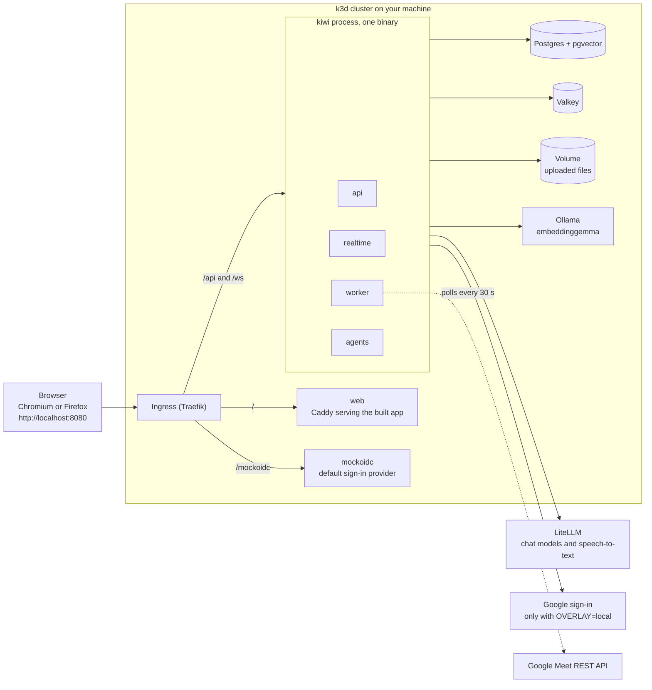

# K.I.W.I.

**Knowledge, Intelligence & Workflow Integration** is a team workspace (channels and real-time chat) with AI agents built in. It turns meetings, uploaded files and conversations into summaries, draft tasks and answers that cite their sources, in English and Thai. Nothing the AI drafts takes effect until a person confirms it.

Built for the AI Builder Cup 2026. **This repository holds the local phase: the whole product runs on one machine**, in a k3d cluster driven by Tilt. There is no deployed instance yet ([Deployment](#deployment-not-yet-built)). All demo content is synthetic.

Every statement here about how something was checked says whether it was **automated**, **simulated** or **real-condition**; the terms are defined in [What was checked, and how](#what-was-checked-and-how).

## What it does: the five demo flows

| # | Flow | What you see |
|---|---|---|
| 1 | Sign in and chat | Sign in with Google and land in `#general`. A message in English or Thai reaches the other member without a reload; a message sent while offline waits, says so, and arrives once when the connection is back. |
| 2 | Meeting summary and action items | A recording uploaded to a channel becomes a summary slip with its decisions, open questions and action items, and AI drafts of the tasks. A Google Meet started from a channel is built to feed the same pipeline, but no real Meet transcript has been obtained (see [Limitations](#limitations-of-this-phase)), so the demo runs this flow on the recording upload. |
| 3 | AI-drafted tasks on the Board | The AI's drafts wait for a person. Pick an owner, press Confirm: the stub tears away, the slip is sealed, and the task lands in To do, from where a menu moves it on. |
| 4 | Cited answers in English and Thai | Ask a question on the Ask page. The answer is a slip with a REF code and clickable sources; a Thai question gets a Thai answer. Someone who is not a member of a channel gets a "not found in channels you can access" answer, never its content. |
| 5 | Instant file summaries | Attach a file to a channel and its summary slip arrives with a REF code. A type that is not supported is refused where it is attached; a scan with no text layer fails with its reason and a Retry button. |

Every AI result is a **slip**: it carries its sources and a REF code (`MTG-…` for a meeting, `DOC-…` for a file, `ANS-…` for an answer, `TSK-…` for a task). A failed attempt shows its reason with Retry and issues no REF.

## How it runs locally



- One Go binary, `kiwi`, runs the four roles (api, realtime, worker, agents) in one process, with an in-process message bus. Work is queued through a transactional outbox in Postgres, so a restart in the middle of a job redelivers it instead of losing it.
- Postgres isolates workspaces with row-level security; Valkey holds sessions, realtime tickets and the fan-out of live events; uploaded files live on a volume and are served through signed URLs.
- Chat models and speech-to-text come from an OpenAI-compatible LiteLLM gateway that your team provides. Embeddings (768 dimensions) come from Ollama in the cluster and run on the CPU.
- Google Meet has no push delivery in this phase: the worker polls the Meet REST API for the meetings you started from K.I.W.I.

## Run it locally

**You need** Docker (running), [mise](https://mise.jdx.dev), and Chromium or Firefox. Run the commands in a shell where mise is activated, or prefix them with `mise exec --`.

### 1. Toolchain and dependencies

```bash
mise install
task setup
```

`mise install` installs the pinned tools of `mise.toml` (Go, Node, pnpm, task, k3d, Tilt, kubectl, kustomize and the rest). `task setup` installs the git hooks (they refuse private paths and secrets before a commit) and the JavaScript dependencies.

### 2. Fill in `.env`

```bash
bash scripts/local/gen-env.sh
```

This creates `.env` from `.env.example` (git-ignored, mode 600) and generates the three local secrets (two keys and the database password). Then edit `.env`. `.env.example` lists every variable name with an empty value; a test keeps it in step with the code. The Secret the cluster reads is built from `.env` by `scripts/local/load-env-secret.sh`; no secret value is ever written into a manifest or committed.

| Variable | Where it comes from |
|---|---|
| `KIWI_LLM_BASE_URL`, `KIWI_LLM_API_KEY` | Your team's LiteLLM gateway, shared out of band. The base URL has no `/v1` suffix: K.I.W.I. appends the API path. |
| `KIWI_LLM_MODEL_FLASH`, `KIWI_LLM_MODEL_PRO`, `KIWI_ASR_MODEL` | Model ids that your LiteLLM serves: two chat models and a speech-to-text model. |
| `KIWI_TOKEN_ENC_KEY`, `KIWI_BLOB_SIGNING_KEY`, `KIWI_DB_PASSWORD` | Generated by `gen-env.sh` when empty (`task local:up` runs it too). A value that is already set is never touched. |
| `KIWI_OAUTH_CLIENT_ID`, `KIWI_OAUTH_CLIENT_SECRET` | The Google OAuth client, needed only for real Google sign-in ([below](#real-google-sign-in)). The default stack signs in through a mock provider and fills in a placeholder itself: leave them empty. |
| `KIWI_WORKSPACE_NAME`, `KIWI_WORKSPACE_DOMAIN` | Optional; they only change the sign-in heading and its domain hint. |
| The rest of `.env.example` | Set by the overlay in `deploy/k8s/overlays`: leave empty. |

### 3. Start the cluster

```bash
task local:up
```

This creates (or starts) the k3d cluster `kiwi`, loads `.env` into the cluster, and runs Tilt with the `mockauth` overlay. Tilt builds the images and deploys Postgres, the migration job, Valkey, Ollama (the first start downloads the embedding model), then `kiwi` and `web`. It stays in the foreground: use a second terminal for the next step, and wait until Tilt shows every resource ready.

### 4. Seed the demo workspace

```bash
task seed
```

With no flags this seeds the workspace `demo.example` with its channels, messages, documents and AI drafts, and invites alice and bob. `task seed -- --help` lists the flags.

### 5. Open the app

Open `http://localhost:8080` in Chromium or Firefox and press **Continue with Google**. The default stack (the `mockauth` overlay, which `task local:up` selects; `OVERLAY=mockauth task local:up` says it explicitly) needs no Google client: the button goes through a mock sign-in provider on the same origin, where a chooser offers three accounts.

| Account | Mock token | Result |
|---|---|---|
| alice@demo.example | has a hosted domain (`demo.example`) | signs in |
| bob@demo.example | no hosted domain; invited by the seed | signs in |
| carol@elsewhere.example | no hosted domain; not invited | refused with K.I.W.I.'s "has not been invited" page |

Use this stack if you are not a test user of the team's Google OAuth app, or not seeded. Stop everything with `task local:down`, which deletes the cluster, its registry and its volumes (so all local data).

### Real Google sign-in

Sign-in is **invite-only**. Only an address that already has a user row can sign in: `kiwi seed --members <emails>` creates them (an invite flow does not exist yet). Any other Google account gets K.I.W.I.'s own "has not been invited" page naming the address. A token that carries a Google Workspace hosted domain (`hd`) must match the domain of an existing workspace; sign-in never creates a workspace.

To set up the Google side (nothing secret goes into the repository):

1. Use one Google Cloud project.
2. Configure the OAuth consent screen as **External** with publishing status **Testing**, and add every person who will sign in as a **test user**. Google stops anyone else with `access_denied`.
3. Request the scopes `openid`, `email`, `profile` and `https://www.googleapis.com/auth/meetings.space.created`.
4. Enable the Google Meet REST API.
5. Create an OAuth client of type **Web application** with the redirect URI `http://localhost:8080/api/auth/callback`.
6. Put its client id and secret into the git-ignored `.env` as `KIWI_OAUTH_CLIENT_ID` and `KIWI_OAUTH_CLIENT_SECRET`.
7. Start the stack with the real sign-in, then seed yourself:

```bash
OVERLAY=local task local:up
task seed -- --members you@gmail.com
```

With `--members` alone, `task seed` creates the one workspace without a Google domain, called "Team". Two demo people, Nok and Pim, on the reserved `.invalid` top-level domain (no Google account can have such an address), own the channels and write the demo conversation; the addresses you list are plain members of the public channels and cannot read the private one. Separate several addresses with commas. Add `--domain <workspace domain>` (together with `--members`) only if your team has a Google Workspace domain.

How this was checked: **real-condition**, by a human, once, through an External/Testing OAuth client: the consent screen, then the "has not been invited" page for a test user who was not yet seeded, then the sign-in of the invited test user. The `hd` (Workspace) branch is built and tested but cannot be exercised for real without a Workspace domain: **automated** and **simulated** checks only.

## Testing

```bash
task test
task lint
task smoke
KIWI_LIVE_E2E=1 task smoke
```

- `task test` runs the Go tests with the race detector, then the TypeScript tests. The Go tests start real Postgres and Valkey containers, so Docker must be running. On rootless Docker, if starting containers fails with `bind: address already in use`, run `cd backend && go test -race -p 1 ./...` instead.
- `task lint` checks Go formatting, runs golangci-lint and the TypeScript linters.
- `task smoke` runs the five flows in headless Chromium (a desktop viewport; flows 1 and 3 again at a 390x844 phone viewport) against the cluster, from a clean state, with a recorded LLM and the mock sign-in, so it needs no model session. **It deletes the application data in the cluster first**, seeds `demo.example`, and leaves the cluster on the `mockauth` overlay. Flags after `--` go to Playwright. It builds the Playwright browsers with Nix when `PLAYWRIGHT_BROWSERS_PATH` is not set; elsewhere, point that variable at a Playwright browsers directory.
- `KIWI_LIVE_E2E=1 task smoke` runs the `@live` tests against the real LiteLLM and Ollama (overlay `mockauth`) instead of the recorded LLM. It is opt-in and never part of the default run; it needs real values in `.env`.
- `task reindex` rebuilds the knowledge embeddings after you change the embedding model.

Pull requests run `.github/workflows/ci.yml` (Go formatting, build and race tests; lint, typecheck and tests of the web workspaces) and the hygiene workflow (no private paths, no secrets). Neither builds an image or deploys.

## What was checked, and how

- **automated**: runs without a person and without a real external service: unit and integration tests, linters, scripts.
- **simulated**: runs against a stand-in: a fake Google client, the mock sign-in provider, recorded LLM replies, a headless browser viewport, jsdom.
- **real-condition**: runs against the real service (real Google, real Meet, a real model) or a physical device.

| Claim | How it was checked | Level |
|---|---|---|
| Google sign-in, invite-only | A human, once, through the External/Testing OAuth client: consent, the invite rejection, the sign-in of an invited test user | **real-condition** |
| The Workspace (`hd`) sign-in branch | Go tests with a fake OIDC provider; flow 1 through the mock provider | **automated**, **simulated** only |
| Start meeting (creating a Meet space) | A human, against the real Meet API, with a personal Google account | **real-condition** |
| The Meet tab opened with `authuser=<your email>` | A human, in a real browser signed in to several Google accounts | **real-condition** |
| Meet offering a transcript to a personal Gmail account | A human, in three real calls: Meet offered neither Transcripts nor "Take notes" | **real-condition**: unavailable for a personal Gmail account |
| Meet transcript polling and ingestion | Go tests with a fake Google client | **simulated**: no real transcript has been ingested |
| The five flows in a browser | The smoke suite (`task smoke`): recorded LLM, mock sign-in, headless Chromium (desktop; flows 1 and 3 also at 390x844) | **simulated** |
| Go and TypeScript logic | `task test`: real Postgres and Valkey in containers, jsdom for the web | **automated** |
| The real LLM and embeddings | The opt-in `KIWI_LIVE_E2E=1 task smoke` only | **real-condition** when run; not part of the default checks |

The five-flow suite has been run on a local docker harness (the real `kiwi`, the recorded LLM, the mock sign-in and headless Chromium; **simulated**), but not through `task smoke`: its first full run on the k3d cluster is pending.

Real-device behaviour of everything on the web side is **simulated** (headless Chromium, jsdom): a physical phone and installing the app as a PWA have not been checked.

## Limitations of this phase

### Google sign-in and Meet

- **Google sign-in and Meet are real only where [What was checked, and how](#what-was-checked-and-how) says so.** Sign-in, Start meeting and the Meet tab were checked against real Google by a human (**real-condition**); transcript polling and ingestion are **simulated** only, because no real transcript has ever been obtained.
- **The app is External in Testing status.** Google expires its refresh tokens after 7 days, so Meet access needs re-consent about weekly: Start meeting sends you through Google's consent screen again (K.I.W.I. forces that screen so a lost grant can be given again). Only test users can sign in, and Google shows an "unverified app" warning.
- **No push delivery.** A transcript is noticed up to 30 seconds (one poll interval) after Meet makes it available, on top of Meet's own delay. Meetings that were not started from K.I.W.I. are never seen.
- **The host's token must stay valid.** If the host revokes access or the refresh token expires, the meeting fails with a reason and a Retry after re-consent.
- **One transcript per meeting.** If transcription is stopped and restarted inside one meeting, only the first transcript is ingested.
- **The live-Meet transcript path is unavailable for a personal Gmail account.** Start meeting works (**real-condition**), but in none of three real calls did Meet offer Transcripts or "Take notes" to the personal Gmail account that hosted the meeting (verified by a human): automatic transcription is a Google Workspace feature. K.I.W.I. creates the space without transcription and tells the host, in English and Thai, to turn it on in Meet if the account offers it. So flow 2, the meeting summary, runs on the recording upload (WAV only), which is the supported route; a meeting that gets no transcript ends as "no transcript" 30 minutes after it ends. The transcript path itself, polling and ingestion, is tested only against a fake Google client; a Google Workspace account that offers transcription has not been tried.
- **The Meet tab opens with `authuser=<your email>`**, so a browser signed in to several Google accounts joins as the space owner. This works on a real multi-account browser (**real-condition**); the parameter is still undocumented by Google, so it may stop working.

### Recordings, models and indexing

- **Recordings must be PCM16 WAV.** Phone recordings (m4a, webm, mp4) are not accepted locally: convert them first.
- **Local transcripts have no speaker names and no timing.** Slips from a recording show no speaker names and no transcript offset links (the interface shows nothing rather than a false `0:00:00`), and tasks drafted from them cite the meeting without a transcript moment.
- **The speech-to-text model runs at about 5 times real time and is shared.** A bad upload can stall it for a minute, hence the strict WAV check.
- **Thai/English code-switched audio is the target; Thai speech recognition quality has only been checked on synthetic speech.**
- **Embeddings run on the CPU.** A large document takes minutes to index.
- A scanned PDF has no text layer and fails with its reason on this provider.

### The web app and devices

- **No Safari.** The session cookie uses the `__Host-` prefix and the stack is served over plain `http://localhost`; Safari is not supported.
- **No phone check.** A phone cannot use this stack over your network, because that cookie needs HTTPS off localhost. The phone layout was checked only in headless Chromium at 390x844 (**simulated**); PWA install has not been checked.
- **Unsent messages are lost on reload.**
- A recording's pending or failed slip follows only the browser session that uploaded it: after a reload, a failed recording shows no slip.
- The message `Meeting started: <link>` is posted under the `@assistant` label: the API has no system author kind.
- Not built: typing and presence indicators, rate limits and spend budgets, Board drag and drop (cards move through a menu).
- No claim about users, connections or requests per second is made for this phase.

## All demo content is synthetic

The people, channels, messages, documents, recordings and meetings in the demo workspace, and every address in this README, are invented. The two demo people use a reserved `.invalid` address and cannot sign in.

## Deployment: not yet built

Nothing in this repository creates a cloud resource, pushes an image or deploys. The binary of this phase cannot serve production by design: it exits at startup when `KIWI_ENV` is prod, because the provider a production deployment requires is not built here.

## Repository layout

| Path | Contents |
|---|---|
| `backend/` | The Go module: `cmd/kiwi` (the one binary: `serve`, `migrate`, `seed`, `reindex`), `internal/` (identity, chat, tasks, docs, meetings, knowledge, agents, realtime, platform), `db/` (migrations and queries), `tools/` (the mock sign-in provider and the LLM replay server used by the smoke run) |
| `apps/web/`, `packages/` | The web app (React, Vite) and its shared packages: `ui`, `core`, `api-client` |
| `proto/` | The protobuf contracts; generated code is committed |
| `deploy/` | The k3d cluster configuration and the kustomize base and overlays (`local`, `mockauth`, `smoke`) |
| `e2e/` | The Playwright smoke suite |
| `scripts/` | Local-cluster, smoke, web and hygiene scripts |
| `Taskfile.yml`, `Tiltfile`, `mise.toml` | The task runner, the Tilt configuration and the toolchain pins |
